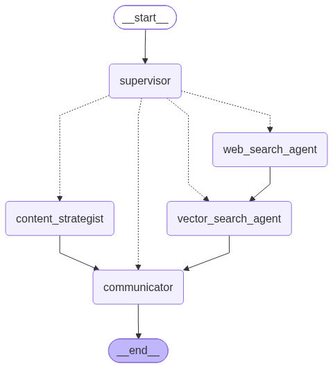

# 랭그래프(LangGraph)를 통한 멀티에이전트 구성

---

## 1. AI 에이전트의 구조와 역할

- 하나의 복잡한 과업(책 목차 작성 및 참고자료 수집)을 수행하기 위해 각기 다른 전공 역할을 가진 AI 에이전트들이 상호 협력하는 멀티에이전트 시스템 구축.



*   **`supervisor` (슈퍼바이저 에이전트 / 조장)**
    *   **역할**: 전체 멀티에이전트 팀의 관리자 및 작업 분담자 역할을 수행합니다.
    *   **원리**: 사용자의 입력, 이전 대화 기록(`messages`), 현재 목차(`outline`), 과거 검색 참고자료(`references`) 및 작업 이력(`task_history`)을 종합 판단하여 다음에 어떤 에이전트가 일을 해야 할지 결정합니다. Pydantic의 `Task` 모델과 `llm.with_structured_output(Task)`를 사용하여 라우팅을 제어합니다.
*   **`content_strategist` (콘텐츠 전략가 에이전트)**
    *   **역할**: 책의 세부 목차(Outline)를 전문적으로 기획, 제안 및 수정합니다.
    *   **원리**: 대화 내용과 수집된 참고 자료(`references`)를 바탕으로 목차를 구상하며, 작성된 목차는 `save_outline()` 함수를 통해 `./data/outline.md` 파일로 즉시 보관 및 업데이트합니다.
*   **`communicator` (커뮤니케이터 에이전트)**
    *   **역할**: 사용자와의 직접적인 인터페이스를 담당하며, 진행 상황과 결과를 사용자에게 보고합니다.
    *   **원리**: 사용자가 이미 화면이나 파일로 확인 중인 목차를 불필요하게 반복 출력하지 않도록 프롬프트 수준에서 가이드를 받아 효율적으로 소통합니다.
*   **`vector_search_agent` (벡터 검색 에이전트)**
    *   **역할**: 로컬 벡터 DB(Chroma DB)에서 목차 작성에 필요한 참고 정보 및 관련 문서를 RAG(검색 증강 생성) 방식으로 추출합니다.
    *   **원리**: LLM에 `.bind_tools([retrieve])` 형태로 벡터 검색 도구를 바인딩하여, 목적에 맞는 검색어들을 능동적으로 생성하고 중복 없이 청크 문서들을 추출해 `references` 상태에 저장합니다.
*   **`web_search_agent` (웹 검색 에이전트)**
    *   **역할**: 벡터 DB에 관련 정보가 부족할 때 인터넷 웹 검색을 수행하여 신규 자료를 수집합니다.
    *   **원리**: Tavily 웹 검색 API와 `WebBaseLoader`를 활용해 검색 결과 전문을 수집한 후, 이를 벡터 DB에 자동 적재(`add_web_pages_json_to_chroma`)하고 바로 `vector_search_agent`로 작업을 연계합니다.


### 전체 실행 흐름 요약
1.  **START -> `supervisor`**: 사용자의 요청이 입력되면 `supervisor`가 현재 `State`를 분석하여 처리 방향을 정합니다.
2.  **분기 처리 (`supervisor_router`)**:
    *   **목차 작성 필요 시**: `content_strategist`로 이동 -> 목차 작성 후 `outline.md` 저장 -> `communicator`로 이동.
    *   **외부 정보 수집 필요 시**: `web_search_agent`로 이동 -> 웹 검색 후 벡터 DB 자동 적재 -> `vector_search_agent`로 자동 연결 -> RAG 검색 수행 후 `communicator`로 이동.
    *   **기존 벡터 DB 검색 필요 시**: `vector_search_agent`로 이동 -> RAG 검색 수행 후 `communicator`로 이동.
    *   **단순 대화 / 경과 보고 시**: `communicator`로 이동.
3.  **`communicator` -> END**: 커뮤니케이터가 작업 결과 및 진행 상황을 사용자에게 최종 답변하고 워크플로를 마무리합니다.


---

## 2. 파이단틱(Pydantic)이란? 작용 원리와 활용 방법

### 개념 및 배경
파이단틱(Pydantic)은 파이썬의 타입 힌트(Type Hints)를 활용하여 데이터의 타입 검증(Validation)과 구조화된 데이터 모델링을 단순하게 구현할 수 있도록 지원하는 라이브러리입니다.

### 필요성 (문제 해결)
`supervisor` 에이전트가 다음 수행할 노드를 결정할 때, 출력 결과를 단순 문자열(`StrOutputParser`)로 받으면 "현재 해야 할 일은 **content_strategist**입니다."와 같이 불필요한 설명 문장이 포함되거나 오타가 발생하여 `KeyError` 및 라우팅 오류가 자주 발생합니다 (특히 GPT-4o-mini 등 소형 모델에서 빈번).

### 작용 원리 및 구현 방법
1.  **`BaseModel` 상속 및 `Literal` 타입 강제**:
    `agent` 필드에 `Literal["content_strategist", "communicator", "web_search_agent", "vector_search_agent"]`를 지정하여 지정된 문자열 집합 외의 다른 문장이 출력되지 않도록 엄격히 제한합니다.
2.  **`Field`를 통한 스키마 서술**:
    각 필드에 `Field(..., description="...")`를 추가하여 LLM이 해당 필드를 어떻게 이해하고 채워야 하는지 명확한 가이드를 제공합니다.
3.  **`with_structured_output` 결합**:
    LangChain LLM 객체에 `llm.with_structured_output(Task)`를 적용함으로써 LLM의 응답이 반드시 Pydantic `Task` 인스턴스 형태로 반환되도록 강제합니다.
4.  **직렬화 및 이력 관리 (`to_dict`)**:
    Pydantic 객체 내에 `to_dict()` 메서드를 구현하여 JSON 파일(`state.json`)로 상태 및 작업 이력을 손쉽게 저장합니다.

```python
# models.py 파일 코드 참고
```

---

## 3. 기존 방식들의 문제점과 RAG 기반 벡터 DB의 필요성

### 기존 방식의 한계
1.  **반복 웹 검색 비용 발생**: 매번 사용자의 질문이나 작업 요청 시마다 외부 웹 검색 API(Tavily 등)를 반복 호출할 경우 상당한 API 이용 비용이 발생합니다.
2.  **토큰(Token) 비용 폭증**: 검색된 웹 문서 전문이나 수십 페이지에 달하는 텍스트 전체를 매번 LLM 대화 히스토리/프롬프트에 입력하면 토큰 사용량이 급격히 증가합니다.
3.  **컨텍스트 윈도우(Context Window) 한계 및 품질 저하**: LLM의 최대 컨텍스트 윈도우 한계에 다다라 오류가 발생하거나, 너무 많은 대량의 텍스트로 인해 LLM의 집중도가 떨어져 답변 품질이 오히려 저하됩니다.

### RAG (검색 증강 생성) 및 벡터 DB
웹 검색이나 파일(PDF 등)에서 읽어온 대용량 문서 전문을 **벡터 DB(Vector DB)**에 한 번 저장해 두면, 질문이 들어왔을 때 관련성이 높은 특정 청크(Chunk) 조각만 추출(RAG)하여 LLM에 최소한의 토큰으로 전달할 수 있습니다. 이를 통해 **비용 절감**, **속도 향상**, **컨텍스트 한계 극복** 및 **정확한 근거 기반 목차 작성**이 가능해집니다.

---

## 4. 원하는 데이터를 벡터 DB에 저장하는 법

PDF 문서나 웹 검색 결과 데이터를 벡터 DB에 저장하는 전체 파이프라인 프로세스는 다음과 같습니다.

```
[원천 데이터 (PDF / 웹페이지)]
        │
        ▼ ( PyPDF / WebBaseLoader)
[LangChain Document 객체 변환] (metadata + page_content)
        │
        ▼ (RecursiveCharacterTextSplitter)
[청크(Chunk) 분할] (chunk_size=1000, chunk_overlap=100)
        │
        ▼ (OpenAIEmbeddings: text-embedding-3-large)
[임베딩 벡터화]
        │
        ▼ (중복 URL 필터링 후 적재)
[Chroma 벡터 DB 저장] (./data/chroma_store)
```

1.  **Document 객체 변환**: `page_content`에 문서 본문을 담고, `metadata`에 원본 URL(`source`)과 제목(`title`) 등의 메타 정보를 결합하여 랭체인 `Document` 객체를 생성합니다.
2.  **청크 분할 (Chunking)**: `RecursiveCharacterTextSplitter`를 사용하여 문맥을 유지할 수 있도록 `chunk_size=1000`, `chunk_overlap=100` 설정으로 문서를 잘게 나눕니다.
3.  **임베딩 생성 (Embedding)**: `OpenAIEmbeddings(model='text-embedding-3-large')` 모델을 활용해 각 청크 텍스트를 고차원 벡터 좌표로 변환합니다.
4.  **중복 저장 방지 및 벡터 DB 적재**: `documents_to_chroma` 함수를 통해 기존 DB 컬렉션에 이미 적재된 문서 URL(`stored_web_urls`)을 확인하고, 신규 URL 청크만 정제하여 Chroma DB (`./data/chroma_store`)에 저장함으로써 데이터 중복 수집 및 RAG 효율 저하를 방지합니다.

---

## 5. 부족한 정보를 보완하는 웹 검색 에이전트 (`web_search_agent`)

### 등장 배경 및 목적
`vector_search_agent`만으로는 초기 벡터 DB에 자료가 부족할 경우 필요한 정보를 충분히 검색할 수 없는 문제가 발생합니다. 이를 보완하기 위해 웹에서 최신 자료를 자동 검색하여 벡터 DB를 채워주는 `web_search_agent`를 추가 구축합니다.

### 작동 매커니즘
1.  **목적 분석 및 키워드 분할**: `supervisor`로부터 부여받은 작업 설명(`mission`)을 바탕으로, 검색어를 복합 키워드가 아닌 세부 키워드로 분할하여 웹 검색을 수행합니다 (예: 'JYP와 HYBE의 연혁' -> 'JYP 연혁', 'HYBE 연혁').
2.  **웹 검색 및 JSON 저장**: `web_search` 도구를 호출하여 Tavily 검색 및 `WebBaseLoader`로 전문을 추출하고 `./data/resources_*.json` 파일로 저장합니다.
3.  **벡터 DB 자동 적재**: `add_web_pages_json_to_chroma` 함수를 실행하여 검색 결과 JSON을 즉시 청크 분할 및 임베딩 후 Chroma DB에 자동 등록합니다.
4.  **`vector_search_agent`로 자동 연계**: 웹 검색 및 DB 적재가 끝나면 작업 목록(`task_history`)에 `vector_search_agent`를 다음 작업으로 등록하여, 새로 보충된 벡터 DB에서 정교한 RAG 검색을 곧바로 이어 수행하도록 설계되었습니다.

---


## 14장 실습 구성 파일의 내부 기능 및 구조 정리

| 파일/폴더명 | 내부 주요 기능 및 역할 |
| :--- | :--- |
| **`book_writer.py`** | **멀티에이전트 메인 오케스트레이터 및 워크플로 파일**<br>- `State` 구조 정의 (`messages`, `task_history`, `references`)<br>- 에이전트 노드 함수 구현 (`supervisor`, `content_strategist`, `communicator`, `vector_search_agent`, `web_search_agent`)<br>- LangGraph `StateGraph` 작성, 노드/조건부 엣지 등록 및 그래프 컴파일<br>- 터미널 대화 루프 실행 및 상태 업데이트 |
| **`models.py`** | **Pydantic 기반 구조화 스키마 파일**<br>- `Task` 클래스 정의 (`agent`, `done`, `description`, `done_at`, `to_dict()`)<br>- LLM 출력을 구조화하여 라우팅 오작동 방지 |
| **`tools.py`** | **검색 및 RAG 처리 도구 모음 파일**<br>- `web_search`: Tavily 기반 웹 검색 도구 (`@tool`)<br>- `load_web_page`: `WebBaseLoader`를 이용한 웹 페이지 전문 로딩<br>- `web_page_json_to_documents`: JSON 데이터를 `Document` 객체 리스트로 변환<br>- `split_documents`: 청크 단위 문서 분할 함수<br>- `documents_to_chroma` / `add_web_pages_json_to_chroma`: 중복 제거 후 Chroma DB 적재<br>- `retrieve`: Chroma 벡터 DB에서 쿼리 기반 청크 검색 도구 (`@tool`) |
| **`utils.py`** | **상태 보존 및 목차 파일 입출력 유틸리티 파일**<br>- `save_state`: 대화 기록, `task_history`, `references` 메타데이터를 `./data/state.json`에 저장<br>- `get_outline`: `./data/outline.md` 파일 읽기 (없을 경우 기본 문구 반환)<br>- `save_outline`: 작성/수정된 목차 텍스트를 `./data/outline.md`에 저장 |
| **`data/` 폴더** | **영속적 실행 데이터 및 DB 저장 디렉토리**<br>- `outline.md`: 콘텐츠 전략가가 생성한 책 목차 마크다운 파일<br>- `state.json`: 시스템 전체 상태 및 작업 이력 JSON 파일<br>- `resources_*.json`: 웹 검색 수행 결과 전문 저장 파일<br>- `chroma_store/`: Chroma 벡터 DB 물리 데이터 저장 폴더 |


